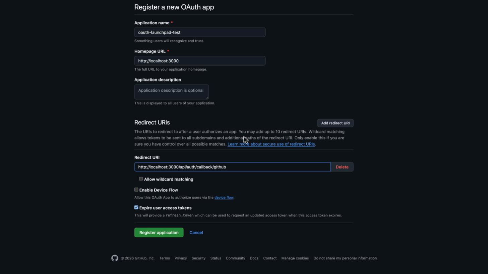
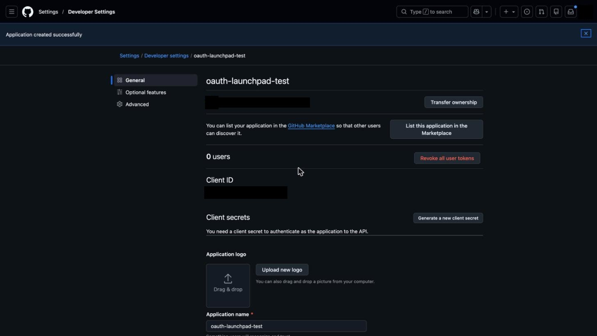
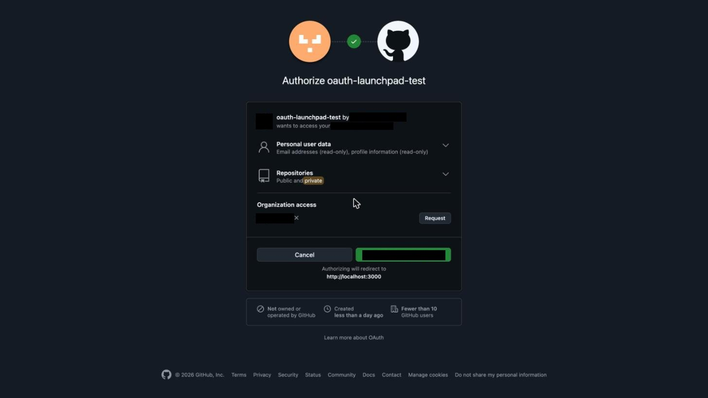

# GitHub: OAuth App for repo-access agent

- **Guide:** [github-oauth-app-repo-access](/g/github-oauth-app-repo-access)
- **Date:** 2026-10-20
- **Operator:** Claude Code agent driving the user's own signed-in Chrome session (claude-in-chrome). The user had already signed in to github.com. The agent did not handle a password, MFA, or any secret.

## Attempt 1

**Status: app registered, consent screen observed. Stopped before authorizing.**

| Phase | Started (UTC) | Ended (UTC) | Measured |
|---|---|---|---|
| Open and fill the form | 2026-10-19T19:53:52Z | 2026-10-19T19:54:50Z | 58 s |
| Paused for user approval to submit | | | not counted |
| Register app, open consent screen | 2026-10-19T19:56:06Z | 2026-10-19T19:57:50Z | 1 min 44 s |
| **Total agent-driven hands-on time** | | | **about 2 min 42 s** |

The timer excludes reading docs, the earlier page load of the developer settings list, and screenshot redaction. A human doing this by hand would be slower. Treat the figure as a lower bound for the click-path only.

### Steps actually attempted
1. Opened https://github.com/settings/developers while signed in. The page showed "No OAuth apps" and a "New OAuth app" button. No gate, verification step, or org requirement appeared.
2. Opened https://github.com/settings/applications/new and filled three fields: Application name `oauth-launchpad-test`, Homepage URL `http://localhost:3000`, Redirect URI `http://localhost:3000/api/auth/callback/github`.
3. Paused and asked the user in chat before submitting. The user approved.
4. Clicked "Register application". GitHub showed "Application created successfully" and a Client ID at once. The app page showed "0 users".
5. Did **not** generate a client secret. The agent would have seen a secret, and nothing needed one yet.
6. Opened the authorize URL with `scope=repo read:user user:email` and the localhost redirect URI.
7. GitHub showed an **account picker** first, because two GitHub accounts were signed in to the browser. Selected the owning account.
8. The consent screen loaded. Took a redacted screenshot. Did **not** click Authorize. Navigated away.

### Observations
- **Redirect URIs:** the form says "You may add up to 10 redirect URIs." Many tutorials still describe a single "Authorization callback URL" field.
- **Wildcard matching:** each redirect URI has an "Allow wildcard matching" checkbox. Help text warns it sends tokens to all subdomains and extra paths.
- **Defaults:** "Expire user access tokens" was pre-checked. "Enable Device Flow" was unchecked.
- **Required fields:** only Application name and Homepage URL. No privacy policy, logo, terms URL, or review form.
- **No review step:** registration finished instantly. No approval, queue, or wait appeared.
- **localhost over http was accepted** as a redirect URI on submit. The consent screen said "Authorizing will redirect to http://localhost:3000".
- **Consent screen wording for these scopes:** "Personal user data: Email addresses (read-only), profile information (read-only)" and "Repositories: Public and private". The word "private" was highlighted.
- **Org access needs a request:** an organization the user belongs to was listed under "Organization access" with an ✕ and a **Request** button. A token from this app would not reach that org's private repos until an org owner approves.
- **Trust signals shown to the end user:** "Not owned or operated by GitHub", "Created less than a day ago", "Fewer than 10 GitHub users". A brand-new agent app looks this way to its first users.
- **Account picker:** appears when several GitHub accounts are signed in. It adds one click before consent.

### What this attempt proves
- A personal account can register an OAuth App instantly, with no review, and gets a Client ID at once.
- A localhost http redirect URI is accepted for development.
- The consent screen for `repo` tells users the app gets public **and private** repositories.
- Org access is per-org and starts unapproved for at least one real org. The user sees a Request button.

### What it does not prove
- The token exchange and an API call. No secret was generated and Authorize was not clicked.
- What the org owner sees, or how long approval takes. No request was sent.
- Whether the org in this test has restrictions on because of the default or an explicit setting.
- Anything about production readiness. Creating an app is not approval, and GitHub does not approve OAuth Apps.

### Cleanup
The test app `oauth-launchpad-test` was deleted on 2026-10-20 after the investigation. It had 0 users and no secret. GitHub reported "Job queued to delete application."

### Remaining manual checklist (pending)
- [ ] Generate a client secret and keep it outside the repo.
- [ ] Click Authorize as a test user. Exchange the code for a token. Call `GET /user` and `GET /user/repos`.
- [ ] Click Request for an org. Record what the org owner sees and how long approval takes.
- [x] Delete the test app (2026-10-20).
