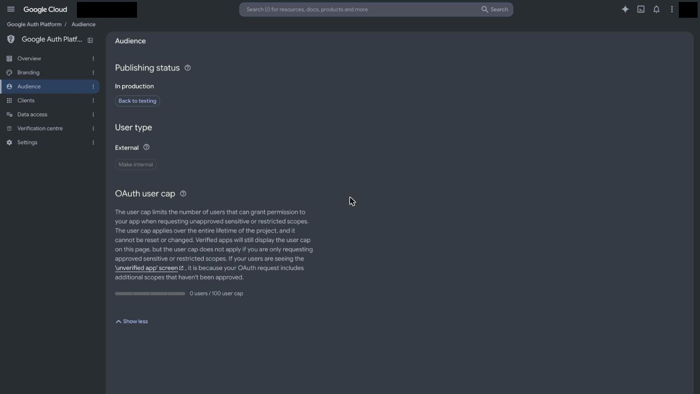
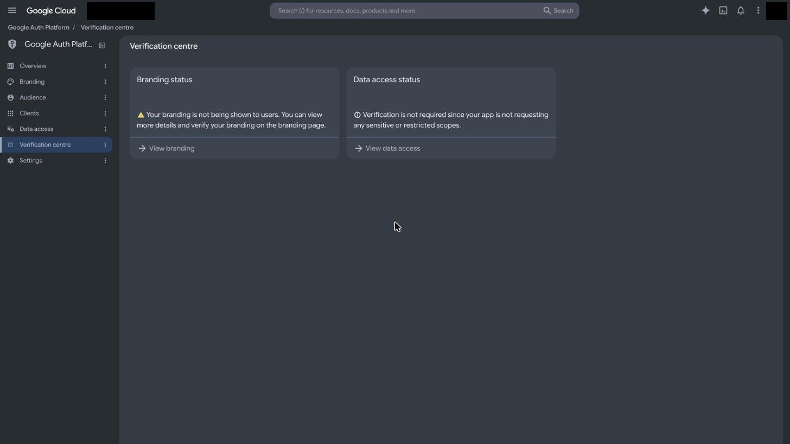

# Google: Auth Platform console, identity-only sign-in

- **Guides:** [google-sign-in-basic-profile](/g/google-sign-in-basic-profile), with consequences for [google-gmail-read-send-agent](/g/google-gmail-read-send-agent)
- **Date:** 2026-10-20
- **Operator:** Claude Code agent driving the user's own signed-in Chrome session. The user was already signed in to Google Cloud. No password, MFA, or secret was handled.

## Attempt 1: read-only inspection of an existing project

**Status: observation only. Nothing was created or changed.**

| Started (UTC) | Ended (UTC) | Measured |
|---|---|---|
| 2026-10-19T19:58:38Z | 2026-10-19T20:00:14Z | 1 min 36 s, page reading only |

This is not a setup duration. No project was created and no OAuth client was made.

### Why read-only
The console opened one of the user's existing projects. Its publishing status was already "In production" with user type External, and it requested no scopes. Changing that project was out of scope. The user approved a form submission for GitHub only. Creating a new Cloud project also needs acceptance of Google Cloud terms if not done before, which is a human step.

### Steps actually attempted
1. Opened https://console.cloud.google.com/auth/overview. The console redirected to an existing project. The left nav reads: Overview, Branding, Audience, Clients, Data access, Verification centre, Settings. That is the current "Google Auth Platform" layout, not the older "OAuth consent screen" page.
2. Opened **Audience** and read the labels.
3. Opened **Verification centre** and read the labels.
4. Opened **Data access** and read the labels.

### Observations, quoted from the console
- **Audience, OAuth user cap:** "The user cap limits the number of users that can grant permission to your app when requesting unapproved sensitive or restricted scopes. The user cap applies over the entire lifetime of the project, and it cannot be reset or changed." The project showed "0 users / 100 user cap" while **In production**.
- The same panel says: "the user cap does not apply if you are only requesting approved sensitive or restricted scopes."
- **Verification centre, Data access status:** "Verification is not required since your app is not requesting any sensitive or restricted scopes."
- **Verification centre, Branding status:** "Your branding is not being shown to users. You can view more details and verify your branding on the branding page."
- **Data access:** "If you add sensitive () or restricted () scopes, like scopes that let you access a user's emails or contacts, you will need to submit your app for verification." Scopes are listed in three tables: non-sensitive, sensitive, restricted.
- Audience offered "Back to testing" and a disabled "Make internal" button. Internal is only offered to projects inside a Google Workspace organization. This project had none.

### What this proves
- The 100-user cap counts users who grant **unapproved sensitive or restricted** scopes. It is a lifetime count per project and cannot be reset. It is shown even when the app is **In production**.
- An app requesting no sensitive or restricted scopes is told verification is not required.
- Without brand verification, the app name and logo are not shown to users.

### What it does not prove
- Behaviour for a project that adds `openid`, `email`, `profile` explicitly. This project listed no scopes at all.
- What an end user sees on consent for an unbranded identity-only app.
- Anything for Gmail scopes. That needs a project requesting restricted scopes.
- Why "Make internal" was disabled. The Workspace-organization reason is inference.

### Remaining manual checklist (pending)
- [ ] Create a fresh Cloud project. Accept terms if prompted; this is a human step.
- [ ] In Branding, set app name and support email. In Audience, keep External and Testing.
- [ ] In Clients, create a "Web application" client with redirect `http://localhost:3000/api/auth/callback/google`. Record whether http localhost is accepted.
- [ ] Sign in with a Google account that is **not** on the test-user list, using only `openid email profile`. Record whether it is blocked or warned.
- [ ] Add `gmail.readonly` in Data access. Record the restricted-scope prompt and what Verification centre asks for.
- [ ] Delete the test project afterwards.
